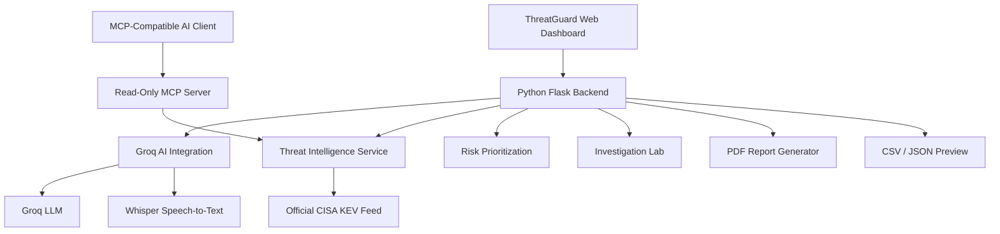

# 🛡️ ThreatGuard MCP
### Intelligent Threat Intelligence. Secure AI Integration. Smarter Vulnerability Decisions.

<p align="center">
  
  
  
  
  
</p>

<p align="center">
  <strong>An AI-integrated cybersecurity intelligence platform that transforms vulnerability data into actionable defensive insights.</strong>
</p>

<p align="center">
  <a href="https://threatguard-mcp.onrender.com/"><strong>🚀 Live Demo</strong></a>
  &nbsp; • &nbsp;
  <a href="https://github.com/rohanbhowm25308/ThreatGuard-MCP"><strong>💻 Source Code</strong></a>
  &nbsp; • &nbsp;
</p>

---

##  Overview

**ThreatGuard MCP AI** is an advanced AI integration and cybersecurity intelligence project that brings together **Model Context Protocol (MCP), Groq-powered language models, speech recognition, threat intelligence APIs, and explainable vulnerability analysis**.

Instead of displaying raw CVE information alone, ThreatGuard provides an interactive environment where users can explore vulnerabilities, ask security questions, investigate relationships, prioritize findings, and generate professional reports.

The platform combines a responsive web dashboard with a standalone read-only MCP server, enabling AI-compatible access to official vulnerability intelligence.

> **Our mission:** Make cybersecurity intelligence more accessible, understandable, and actionable through secure AI integration.

## ✨ Key Features

###  01 — Groq AI Security Assistant

An integrated conversational AI assistant for cybersecurity analysis.

- Ask natural-language questions about CVEs and vulnerabilities.
- Receive explanations of security concepts and mitigation strategies.
- Analyze selected vulnerability records with AI assistance.
- Interact through a responsive chat interface.
- Keep API credentials on the backend.

**Powered by:** Groq API and `openai/gpt-oss-20b`.

###  02 — AI Voice Interaction

Interact with the AI assistant using your voice.

- Record questions through your microphone.
- Convert speech into text using Groq Whisper.
- Review and edit the transcription before sending.
- Continue the conversation through the AI chat interface.

**Speech model:** `whisper-large-v3-turbo`.

###  03 — AI Threat Risk Predictor

Turn vulnerability information into explainable security priorities.

- Select a CVE from the active dataset.
- View a visual prioritization score.
- Examine the indicators contributing to the score.
- Understand why certain vulnerabilities deserve attention.

**Important:** The prioritization score is an explainable triage indicator, not a statistical prediction of future exploitation.

###  04 — AI Threat Investigation Lab

Explore vulnerabilities through an interactive investigation environment.

- Build relationship graphs around selected CVEs.
- Connect vulnerabilities with vendors and affected products.
- Explore defensive investigation actions.
- Request Groq-powered explanations of selected findings.

###  05 — Automated Security Report Generator

Transform vulnerability datasets into structured PDF reports.

Reports can include:

- Executive overview
- Vulnerability findings
- Prioritization indicators
- Remediation guidance
- Data-source limitations

Reports are generated on demand without persisting uploaded datasets on the server.

###  06 — CVE Intelligence Explorer

Search and examine known exploited vulnerabilities.

- CVE identifier search
- Vendor and product filtering
- Keyword-based exploration
- Vulnerability descriptions
- Official CISA KEV intelligence

###  07 — Read-Only MCP Server

A standalone Python Model Context Protocol server that exposes threat intelligence through controlled, read-only tools.

**Available MCP tools:**

| Tool | Purpose |
|---|---|
| `get_latest_vulnerabilities` | Retrieve recently added vulnerability records |
| `get_vulnerability` | Retrieve details for a specific CVE |
| `search_vulnerabilities` | Search vulnerability intelligence |
| `get_catalog_stats` | Retrieve catalog statistics |

The MCP server uses stdio transport and is intended for integration with compatible MCP clients.

###  08 — CSV and JSON Intelligence Upload

Bring your own vulnerability data into the dashboard.

- CSV and JSON support
- Up to 25 MB per upload
- Up to 20,000 records
- CVE identifier validation
- Temporary in-memory preview
- No server-side persistence of uploaded datasets

###  09 — Cybersecurity Intelligence Dashboard

A futuristic dashboard featuring:

- Animated dotted/starfield visuals
- Responsive navigation
- Vulnerability statistics
- Security activity feed
- Interactive data exploration
- Dedicated AI investigation workspaces

---

##  System Architecture



### Architectural Principles

**Separation of concerns:** The Flask dashboard and standalone MCP server use a shared threat-intelligence service.

**Read-only access:** The MCP interface provides vulnerability retrieval tools without catalog modification operations.

**Server-side AI integration:** Groq credentials remain outside frontend JavaScript.

**Explainable analysis:** Vulnerability prioritization exposes contributing factors rather than presenting unsupported predictions.

---

##  Technology Stack

| Layer | Technologies |
|---|---|
| Frontend | HTML5, CSS3, JavaScript |
| Backend | Python, Flask |
| AI Integration | Groq API |
| Language Model | OpenAI GPT-OSS 20B via Groq |
| Speech AI | Whisper Large V3 Turbo |
| AI Tool Protocol | Model Context Protocol (MCP) |
| Threat Intelligence | CISA KEV |
| Reporting | ReportLab |
| Deployment | Render, Gunicorn |
| Version Control | Git, GitHub |
| Security | Input validation, rate limiting, logging |

---

##  Live Application

**Experience ThreatGuard MCP AI:**

### https://threatguard-mcp.onrender.com/

Explore the application through its dedicated workspaces:

1. Overview
2. CVE Explorer
3. Activity Feed
4. MCP Architecture
5. CSV / JSON Upload
6. Groq AI Chat
7. AI Threat Risk Predictor
8. AI Investigation Lab
9. Security Reports

The dashboard offers three intelligence-source options: demo data, temporary user-uploaded data, and live CISA KEV.

---

##  Installation and Setup

### Prerequisites

- Python 3.10+
- Git
- Internet connection for live threat intelligence and Groq API access
- Groq API key for AI-powered features

### 1. Clone the repository

```bash
git clone https://github.com/rohanbhowm25308/ThreatGuard-MCP.git
cd ThreatGuard-MCP
```

### 2. Create a virtual environment

**Windows:**

```powershell
python -m venv .venv
.\.venv\Scripts\Activate.ps1
```

**macOS / Linux:**

```bash
python3 -m venv .venv
source .venv/bin/activate
```

### 3. Install dependencies

```bash
pip install -r requirements.txt
```

### 4. Configure environment variables

Copy `.env.example` to `.env`, then configure:

```env
GROQ_API_KEY=your_groq_api_key_here
GROQ_MODEL=openai/gpt-oss-20b
GROQ_WHISPER_MODEL=whisper-large-v3-turbo
```

Never commit `.env` or real API credentials to GitHub.

### 5. Start the application

```bash
python app.py
```

Open:

```text
http://127.0.0.1:5000
```

---

##  Running the MCP Server

The standalone MCP server can be connected to an MCP-compatible client.

```bash
python mcp_server.py
```

For an MCP client using stdio transport, configure the Python executable and absolute path to `mcp_server.py` according to that client's configuration format.

The deployed Flask website is a separate HTTP application; the standalone MCP server is not automatically exposed as a public remote MCP endpoint.

---

##  Deployment on Render

ThreatGuard can be deployed as a Python Web Service on Render.

**Build Command:**

```bash
pip install -r requirements.txt
```

**Start Command:**

```bash
gunicorn app:app --bind 0.0.0.0:$PORT --timeout 120
```

Configure the Groq environment variables in the Render dashboard.

For production use, review authentication, proxy configuration, rate limiting, resource usage, and the security review before allowing untrusted public traffic.

---

##  Security Architecture

ThreatGuard incorporates security-focused design choices:

| Security Control | Purpose |
|---|---|
| Read-only MCP tools | Reduce the risk of unauthorized catalog modification |
| Input validation | Reject malformed or unsupported inputs |
| Rate limiting | Limit excessive API and tool requests |
| Security logging | Support request monitoring and troubleshooting |
| Server-side API credentials | Prevent direct exposure of Groq keys in frontend code |
| Upload validation | Enforce file and record constraints |
| Request timeouts | Reduce the impact of unresponsive upstream services |

### Security Considerations

This project is an educational AI integration and cybersecurity prototype.

- In-memory rate limits are not equivalent to distributed production rate limiting.
- Public deployments should use appropriate authentication and operational controls.
- Uploaded records and AI responses must be treated as untrusted information.
- AI-generated guidance should be verified against official security advisories.
- CISA KEV covers known exploited vulnerabilities, not the entire CVE ecosystem.

Read the project's [Security Review](https://github.com/rohanbhowm25308/ThreatGuard-MCP/blob/main/docs/SECURITY_REVIEW.md) for additional details.

---

## 🧪 Testing

Run the automated test suite:

```bash
python -m pytest -q
```

Recommended validation areas include:

- CVE identifier handling
- API input validation
- Read-only MCP behavior
- Rate-limit enforcement
- Upload validation
- Upstream feed failure handling
- AI API error handling
- Report generation

---

##  Project Domain — Advanced AI Integration

ThreatGuard MCP AI was developed as an **Advanced AI Integration Internship Project**.

The project demonstrates practical integration of:

- Large Language Models with Python backend services
- AI APIs with external cybersecurity intelligence
- Model Context Protocol tools
- Speech-to-text AI services
- Explainable decision-support workflows
- Automated document generation
- Security controls for AI-enabled applications

The primary focus is not training an AI model from scratch, but **integrating AI capabilities into a functional, security-conscious software system**.

---

##  Data Sources and References

- [CISA Known Exploited Vulnerabilities Catalog](https://www.cisa.gov/known-exploited-vulnerabilities-catalog)
- [Model Context Protocol](https://modelcontextprotocol.io/)
- [Groq Documentation](https://console.groq.com/docs)
- [Flask Documentation](https://flask.palletsprojects.com/)
- [Render Documentation](https://render.com/docs)

---

## 👨‍💻 Developer

**Rohan Bhowmik**

*AI/ML Developer | Data Science Enthusiast | Generative AI | AI Integration & Web Devloper*

Passionate about building practical AI-powered applications that connect intelligent models with real-world problems.

<p align="center">
  <a href="https://github.com/rohanbhowm25308">
    
  </a>
  <a href="https://www.linkedin.com/in/rohan-bhowmik-b014473a1">
    
  </a>
  <a href="https://venerable-lamington-90daf4.netlify.app/">
    
  </a>
</p>

---

## ⭐ Support the Project

If you find ThreatGuard MCP useful, consider giving the repository a star.

Your feedback and contributions are welcome.

<p align="center">
  <strong>🛡️ ThreatGuard MCP </strong>
</p>

<p align="center">
  <em>From Vulnerability Data to Intelligent Defense.</em>
</p>

<p align="center">
  Built with Python • Powered by AI • Engineered for Security
</p>

<p align="center">
  © ThreatGuard MCP
</p>
